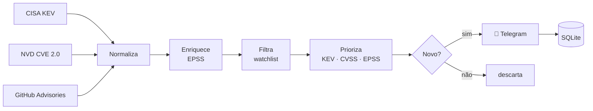

<div align="center">

# 🗼 Atalaia

**Vulnerability & Threat Intelligence Alerts**

Vigia as fontes oficiais de Threat Intel e dá o alarme no Telegram só quando importa — priorizado por risco real.

[](https://github.com/MatheussTrindade/Atalaia/actions/workflows/ci.yml)


[Brain](#-brain-do-projeto) · [Como funciona](#%EF%B8%8F-como-funciona) · [Estrutura](#-estrutura) · [Setup](#-setup) · [Segurança](#-segurança) · [Roadmap](#%EF%B8%8F-roadmap)

</div>

---

## 🧠 Brain do projeto

### O problema

São publicadas **dezenas de milhares de CVEs por ano**. Nenhum time consegue olhar todas, e
CVSS alto sozinho não significa risco real — a maioria das vulnerabilidades **nunca é
explorada**. O resultado é fadiga de alertas: o que é crítico se perde no meio do ruído.

### A ideia

Ser a **atalaia** — a torre de vigia que observa o horizonte e dá o alarme antes do ataque.
O bot monitora as fontes oficiais de Threat Intel e só alerta no Telegram sobre o que:

1. **Afeta a minha stack** → casa com a *watchlist* (vendors, produtos, ecossistemas);
2. **Tem chance real de ser explorado** → está no **CISA KEV** ou tem **EPSS** alto;
3. **Ainda não foi avisado** → deduplicação persistente.

### Por que KEV + EPSS + CVSS

| Sinal | Pergunta que responde | Fonte |
|---|---|---|
| **CVSS** | *Quão grave é se for explorada?* | NVD |
| **EPSS** | *Qual a chance de ser explorada nos próximos 30 dias?* | FIRST |
| **KEV** | *Já está sendo explorada agora?* | CISA |

Combinar os três é o que equipes de Vulnerability Management usam para **priorizar por
risco**, e não só por severidade.

### Regra de priorização (v1)

| Nível | Critério |
|---|---|
| 🔴 **CRÍTICO** | Está no CISA KEV (exploração ativa confirmada) |
| 🟠 **ALTO** | CVSS ≥ 9.0 **ou** EPSS ≥ 0.5 |
| 🟡 **MÉDIO** | CVSS ≥ 7.0 **ou** EPSS ≥ 0.1 |
| ⚪ **INFO** | Demais itens da watchlist |

### Como fica o alerta

```text
🔴 CRÍTICO · Explorada ativamente (CISA KEV)

CVE-2026-12345 — Fortinet FortiOS
Heap overflow no SSL-VPN permite RCE sem autenticação.

📊 CVSS 9.8 · EPSS 0.94 (top 1%)
⏰ Prazo CISA para correção: 2026-11-28
🔗 Advisory do fabricante · NVD
```

### Princípios

- **Sinal > ruído:** melhor 3 alertas certos do que 300 ignorados.
- **Somente fontes oficiais:** APIs públicas e documentadas, dentro dos termos de uso.
- **Seguro por padrão:** o próprio bot segue as práticas que um analista de segurança cobraria.

> 📜 As decisões de arquitetura estão registradas em [docs/adr/](docs/adr/) — comece pela
> [priorização por risco](docs/adr/0001-priorizacao-por-risco.md).

---

## ⚙️ Como funciona



Detalhes em [docs/architecture.md](docs/architecture.md) · Fontes em [docs/data-sources.md](docs/data-sources.md).

---

## 📁 Estrutura

```text
Atalaia/
├── app/
│   ├── __main__.py              # python -m app
│   ├── main.py                  # entrypoint e agendamento
│   ├── config/
│   │   └── settings.py          # configs tipadas (pydantic-settings) + SecretStr
│   ├── collectors/              # 1 módulo por fonte de Threat Intel
│   │   ├── base.py              # contrato comum dos coletores
│   │   ├── cisa_kev.py
│   │   ├── nvd.py
│   │   ├── github_advisories.py
│   │   └── abusech.py
│   ├── enrichers/
│   │   └── epss.py              # probabilidade de exploração (FIRST)
│   ├── core/
│   │   ├── pipeline.py          # collect → enrich → filter → score → notify
│   │   ├── filters.py           # watchlist e thresholds
│   │   └── scoring.py           # regra de priorização
│   ├── models/
│   │   ├── vulnerability.py     # modelo normalizado
│   │   └── alert.py             # alerta + severidade
│   ├── notifiers/
│   │   ├── base.py
│   │   ├── formatter.py         # HTML seguro (escape)
│   │   └── telegram.py
│   ├── storage/
│   │   └── state.py             # deduplicação e checkpoints (SQLite)
│   └── utils/
│       ├── http.py              # sessão HTTP segura (TLS, timeout, retry)
│       └── logger.py            # logging com redação de segredos
├── config/
│   └── watchlist.example.yaml   # stack monitorada
├── data/                        # estado local (ignorado pelo git)
├── docs/
│   ├── architecture.md
│   ├── data-sources.md
│   ├── threat-model.md
│   └── adr/                     # decisões de arquitetura (ADRs)
├── tests/
│   ├── unit/
│   ├── integration/
│   └── fixtures/                # respostas de API gravadas
├── .github/
│   ├── workflows/ci.yml         # gitleaks · ruff · bandit · pip-audit · pytest
│   ├── dependabot.yml
│   ├── ISSUE_TEMPLATE/
│   └── pull_request_template.md
├── .env.example
├── .pre-commit-config.yaml
├── Dockerfile                   # imagem slim, usuário não-root
├── pyproject.toml
├── requirements.txt             # runtime (versões fixadas)
├── requirements-dev.txt         # qualidade e segurança
├── CHANGELOG.md
├── SECURITY.md
└── LICENSE
```

---

## 🚀 Setup

> ⚠️ Projeto em construção: a estrutura está pronta e os módulos estão sendo implementados
> (veja o [Roadmap](#%EF%B8%8F-roadmap)).

**Pré-requisitos:** Python 3.12+ e um bot criado no [@BotFather](https://t.me/BotFather).

```bash
git clone https://github.com/MatheussTrindade/Atalaia.git
cd Atalaia

python -m venv .venv
source .venv/bin/activate          # Windows: .venv\Scripts\activate

pip install -r requirements-dev.txt
pre-commit install

cp .env.example .env                                   # preencha os tokens
cp config/watchlist.example.yaml config/watchlist.yaml # ajuste sua stack

python -m app
```

**Com Docker:**

```bash
docker build -t atalaia .
docker run --env-file .env -v ./data:/app/data -v ./config:/app/config atalaia
```

### Variáveis de ambiente

| Variável | Obrigatória | Descrição |
|---|---|---|
| `TELEGRAM_TOKEN` | ✅ | Token do bot (BotFather) |
| `TELEGRAM_CHAT_ID` | ✅ | ID do grupo/canal de destino |
| `NVD_API_KEY` | — | Aumenta o rate limit da NVD |
| `GITHUB_TOKEN` | — | Token fine-grained somente leitura |
| `ABUSECH_AUTH_KEY` | — | Habilita ThreatFox (fase 3) |
| `POLL_INTERVAL_MINUTES` | — | Intervalo entre execuções (padrão `30`) |
| `LOG_LEVEL` | — | `DEBUG`, `INFO`, `WARNING`... |

---

## 🔒 Segurança

O bot lida com tokens e publica conteúdo externo — por isso segue as mesmas práticas que
cobraria de qualquer outro sistema:

| Controle | Como |
|---|---|
| **Secret scanning** | gitleaks no pre-commit e no CI |
| **SAST** | bandit + regras `S` do ruff |
| **SCA** | pip-audit no CI + Dependabot semanal |
| **Segredos** | só via ambiente, `SecretStr`, redação no logger |
| **Transporte** | TLS sempre verificado, timeout em toda requisição |
| **Saída** | escape de HTML em todo conteúdo vindo das fontes |
| **Runtime** | container slim, usuário não-root, sem segredos na imagem |
| **CI** | `permissions: contents: read` (menor privilégio) |

📄 [Threat model](docs/threat-model.md) · 🛡️ [Como reportar uma vulnerabilidade](SECURITY.md)

---

## 🗺️ Roadmap

**Fase 0 — Fundação** ✅
- [x] Estrutura modular e documentação
- [x] CI de segurança (gitleaks, bandit, pip-audit, ruff, pytest)
- [x] Threat model, SECURITY.md, Dockerfile não-root

**Fase 1 — MVP**
- [ ] Cliente HTTP seguro e logger com redação
- [ ] Coletor CISA KEV
- [ ] Coletor NVD + enriquecimento EPSS
- [ ] Watchlist, filtros e priorização
- [ ] Notifier Telegram + deduplicação em SQLite
- [ ] Testes com fixtures de API

**Fase 2 — Cobertura**
- [ ] GitHub Security Advisories (pip, npm, maven)
- [ ] Resumo diário/semanal
- [ ] Comandos no bot (`/status`, `/watchlist`, `/cve CVE-XXXX-XXXX`)

**Fase 3 — Threat Intel**
- [ ] IOCs do abuse.ch (ThreatFox)
- [ ] Mapeamento para MITRE ATT&CK
- [ ] Novos canais (Slack, Discord, e-mail)

---

## 📄 Licença

Distribuído sob a licença [MIT](LICENSE).

<div align="center">

Feito por **[Matheus Trindade](https://github.com/MatheussTrindade)** · 🗼 *vigilância contínua, alerta só quando importa*

</div>
